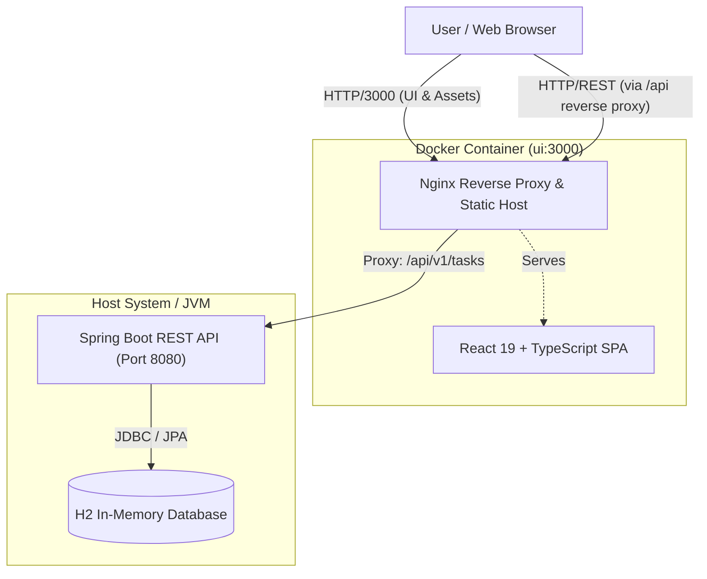

# Task Management Application Architecture Documentation

Welcome to the architectural documentation for the **Task Management Application**.

This documentation suite provides a comprehensive, rigorous, and standard-compliant description of the system architecture. It adheres strictly to internationally recognized software engineering documentation standards:

1. **[arc42 Template (v8.2)](./arc42/index.md)**: The open-source standard for software architecture documentation (aligned with ISO/IEC/IEEE 42010).
2. **[C4 Model](./c4-model/README.md)**: Simon Brown's hierarchical architectural visualization framework (Context, Containers, Components, Code).
3. **[Architecture Decision Records (ADR)](./adr/README.md)**: Michael Nygard's format for capturing foundational architectural choices, alternatives, and rationale.

---

## 🧭 Documentation Navigation

```text
docs/
├── README.md                           # Main Architecture Overview & Navigation Guide (this file)
├── arc42/                              # arc42 Software Architecture Document
│   ├── index.md                        # Master arc42 Document & Executive Summary
│   ├── 01_introduction_and_goals.md    # Requirements, quality goals, stakeholders
│   ├── 02_architecture_constraints.md  # Technical, organizational, conventions
│   ├── 03_context_and_scope.md         # Business & technical context, boundaries
│   ├── 04_solution_strategy.md         # Key strategies, design patterns, decisions
│   ├── 05_building_block_view.md       # Whitebox component hierarchy (C4 Levels 2 & 3)
│   ├── 06_runtime_view.md              # Dynamic workflows & sequence diagrams
│   ├── 07_deployment_view.md           # Infrastructure, Docker, Nginx, ports
│   ├── 08_crosscutting_concepts.md     # Error handling, validation, DTOs, data persistence
│   ├── 09_architectural_decisions.md   # ADR catalogue reference
│   ├── 10_quality_requirements.md      # ISO 25010 Quality Tree & ATAM scenarios
│   ├── 11_risks_and_technical_debt.md  # Known risks, mitigations, technical debt
│   └── 12_glossary.md                  # Ubiquitous language & technical terms
├── c4-model/                           # C4 Model Visualizations
│   ├── README.md                       # C4 Model Overview
│   ├── 01-system-context.md            # Level 1: System Context Diagram
│   ├── 02-container-view.md            # Level 2: Container Diagram
│   ├── 03-component-view.md            # Level 3: Component Diagrams (Frontend & Backend)
│   └── 04-code-and-data-model.md       # Level 4: Code & Data Entity Relationships
└── adr/                                # Architecture Decision Records
    ├── README.md                       # ADR Overview & Status Matrix
    ├── 0001-record-architecture-decisions.md
    ├── 0002-decoupled-spa-and-rest-api.md
    ├── 0003-spring-boot-layered-backend.md
    ├── 0004-in-memory-h2-database.md
    ├── 0005-nginx-reverse-proxy-container.md
    ├── 0006-react-context-state-management.md
    └── 0007-dto-and-domain-entity-separation.md
```

---

## 🏛️ Architecture at a Glance

The Task Management Application is a modern full-stack web application implementing a **decoupled Client-Server architecture** with a reactive single-page frontend and a layered RESTful backend:



### Core Architecture Characteristics

| Dimension | Implementation Details |
| :--- | :--- |
| **Architectural Style** | Decoupled Client-Server (SPA + Stateless REST API) |
| **Backend Architecture** | Classic Layered Architecture (Controller &rarr; Service &rarr; Repository &rarr; Database) |
| **Backend Stack** | Java 25, Spring Boot 4.0.9, Spring Data JPA, Hibernate, H2 In-Memory Database |
| **Frontend Stack** | React 19, TypeScript 5.9, Vite 7, Tailwind CSS, Radix UI Primitives |
| **State Management** | Centralized unidirectional state via React Context API (`TaskContext`) |
| **Containerization** | Multi-stage Docker build (Node.js 22 &rarr; Nginx Alpine) with dynamic proxy templating |
| **Communication Protocol** | RESTful HTTP/JSON over standard HTTP methods (`GET`, `POST`, `PUT`, `DELETE`) |
| **Data Integrity** | Jakarta Validation annotations with Spring `@ControllerAdvice` global exception translation |

---

## 🚀 Recommended Reading Paths

- **For New Developers / Engineers**:
  1. Start with [C4 Level 1 Context](./c4-model/01-system-context.md) and [C4 Level 2 Container](./c4-model/02-container-view.md).
  2. Read [arc42 Building Block View](./arc42/05_building_block_view.md) and [arc42 Solution Strategy](./arc42/04_solution_strategy.md).
  3. Review the [Architecture Decision Records (ADRs)](./adr/README.md) to understand why decisions were made.
- **For DevOps / SRE**:
  1. Review [arc42 Deployment View](./arc42/07_deployment_view.md) and [Container View](./c4-model/02-container-view.md).
  2. Inspect [ADR-0005: Nginx Reverse Proxy Container](./adr/0005-nginx-reverse-proxy-container.md).
- **For Architects & Tech Leads**:
  1. Read the complete [arc42 Architecture Guide](./arc42/index.md).
  2. Review [arc42 Quality Requirements](./arc42/10_quality_requirements.md) and [Risks & Technical Debt](./arc42/11_risks_and_technical_debt.md).
