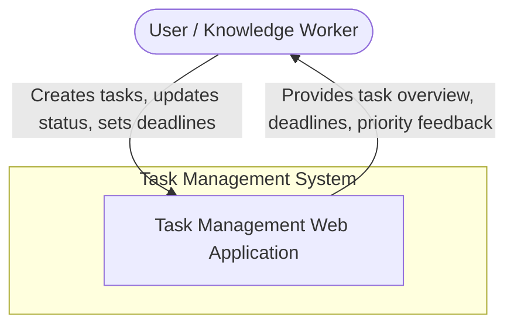
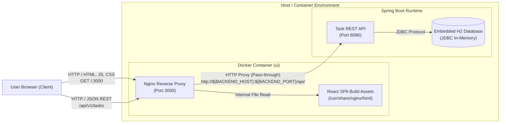

# 3. Context and Scope

The context boundary isolates the Task Management System from external actors, defining inbound and outbound data flows, protocols, and technical dependencies.

---

## 3.1 Business Context

The business context illustrates the interaction between external domain actors (users) and the system.

### Business Actors and Use Cases

| Actor | Responsibility | System Interaction |
| :--- | :--- | :--- |
| **End User** | Manages daily workloads and project checklists. | - Views list of active tasks. - Creates new task with title, priority, due date, description. - Toggles task completion status. - Edits existing task attributes. - Deletes obsolete tasks. |

---

## 3.2 Technical Context

The technical context describes physical communication paths, transport protocols, network ports, and payloads traversing the system boundary.

### Technical Interface Specifications

| Interface | Protocol | Port / Location | Data Format | Description |
| :--- | :--- | :--- | :--- | :--- |
| **User Interface** | HTTP 1.1 | `http://localhost:3000/` | HTML5, CSS3, JavaScript | Serves the single-page application bundle and visual UI components. |
| **Frontend Reverse Proxy** | HTTP 1.1 | `:3000/api/*` &rarr; `:8080/api/*` | JSON (UTF-8) | Forwards API requests from the browser to the backend without triggering browser CORS restrictions. |
| **Backend REST API** | HTTP 1.1 | `http://localhost:8080/api/v1/tasks` | JSON (UTF-8) | Exposes CRUD operations, accepts request payloads, and responds with status codes and DTOs. |
| **Persistence Link** | JDBC | `jdbc:h2:mem:taskdb` | SQL / Binary | Inter-process communication between Spring Data JPA (Hibernate) and the in-memory H2 database engine. |
