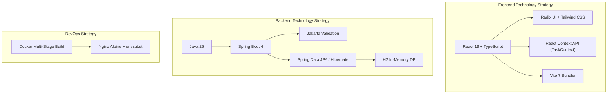

# 4. Solution Strategy

The solution strategy summarizes the fundamental decisions and design patterns chosen to satisfy the system's functional and quality goals.

---

## 4.1 Fundamental Architecture Decisions

### 1. Decoupled Client-Server Architecture
- **Decision**: Physically and logically decouple the frontend application (React SPA) from the backend API (Spring Boot).
- **Rationale**: Enables independent technology evolution, distinct deployment cycles, rapid UI iterations without backend re-compilations, and potential future support for multiple clients (e.g., mobile apps, CLI tools).

### 2. Classic Layered Backend Architecture (N-Tier)
- **Decision**: Organize the backend into four distinct horizontal layers:
  1. *Presentation Layer* (`controller`): Handles HTTP routing, JSON serialization/deserialization, parameter extraction, and validation invocation.
  2. *Domain / Mapping Layer* (`domain`, `mapper`): Contains data structures, DTOs, and explicit transformation logic between external contracts and internal domain representations.
  3. *Business Service Layer* (`service`): Implements business rules, timestamping, entity mutation, sorting, and exception propagation.
  4. *Data Access Layer* (`repository`): Encapsulates persistence interactions using Spring Data JPA.
- **Rationale**: Strict separation of concerns simplifies unit testing, isolates framework concerns from business logic, and ensures maintainability.

### 3. Separation of DTOs and Persistence Entities
- **Decision**: External API contracts (`CreateTaskRequestDto`, `UpdateTaskRequestDto`, `TaskDto`) are strictly segregated from JPA database entities (`Task`).
- **Rationale**: Prevents accidental exposure of sensitive entity internals, prevents mass assignment vulnerabilities, and allows database schemas to evolve independently from external API contracts.

### 4. Reverse Proxy Deployment Topology (Nginx)
- **Decision**: Package the frontend inside a lightweight Nginx container that acts as both static asset server and reverse proxy for backend API calls.
- **Rationale**: Solves Cross-Origin Resource Sharing (CORS) issues naturally, as the browser treats frontend static assets and API requests under the same origin (`http://localhost:3000`).

---

## 4.2 Technology Decisions & Rationales

| Area | Choice | Rationale | Alternatives Considered |
| :--- | :--- | :--- | :--- |
| **Frontend Framework** | React 19 + TypeScript 5.9 | Industry-standard component model, high developer velocity, strict static type safety matching Java backend types. | Vue.js, Angular, Vanilla JS |
| **Styling & Components** | Tailwind CSS + Radix UI | Headless accessible UI primitives (Radix) styled with utility classes (Tailwind) ensure accessible dialogs, popovers, and responsive layout. | Material UI, Bootstrap, CSS Modules |
| **Backend Framework** | Spring Boot 4.0.9 | Mature enterprise framework, robust dependency injection, declarative validation, and battle-tested ecosystem. | Quarkus, Micronaut, Express.js |
| **Language Features** | Java 25 Records | Immutable data carriers with automatic `equals`, `hashCode`, and constructors, reducing boilerplate for DTOs and requests. | Lombok, Plain JavaBeans |
| **Persistence Engine** | Spring Data JPA (Hibernate) | Eliminates repetitive SQL queries, generates standard CRUD operations automatically, provides type-safe repository abstractions. | MyBatis, Raw JDBC, jOOQ |
| **Database** | H2 In-Memory Database | Zero external setup for immediate developer onboarding and integration testing. | PostgreSQL, MySQL, SQLite |
