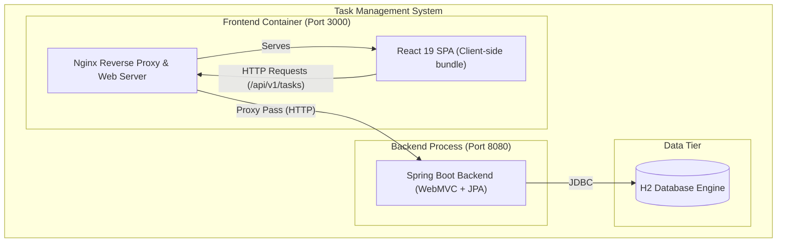
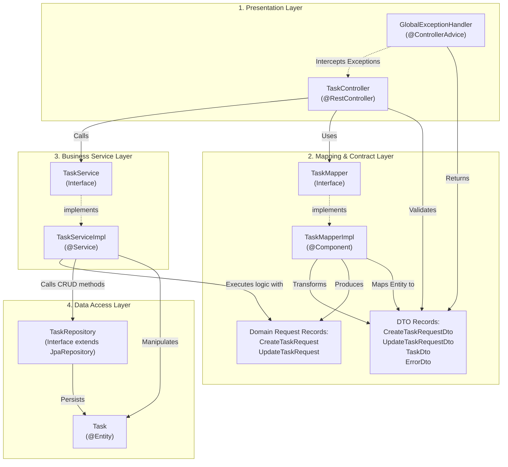
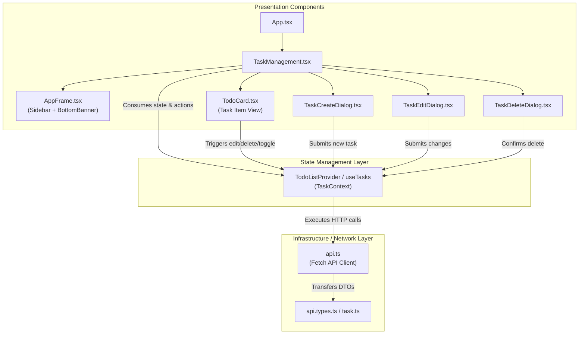

# 5. Building Block View

The Building Block View provides a static decomposition of the system into subsystems, components, and packages, descending through levels of abstraction (aligned with C4 Levels 2 and 3).

---

## 5.1 Level 1: Whitebox Overall System

The overall system comprises three primary runtime units:
1. **Frontend Container (`ui`)**: Serves single-page application assets and proxies API calls via Nginx.
2. **Backend Application (`task`)**: Spring Boot REST application executing business logic and data access.
3. **Database (`h2`)**: In-memory relational database storing task records.

---

## 5.2 Level 2: Subsystem Decomposition

### 5.2.1 Backend Subsystem (`com.armannqz.task`)

The backend is decomposed into distinct, cohesive packages adhering to a strict layered architecture:

#### Detailed Responsibilities of Backend Blocks

| Component / Block | Package | Responsibilities | Collaborators |
| :--- | :--- | :--- | :--- |
| `TaskController` | `com.armannqz.task.controller` | Exposes REST endpoints (`/api/v1/tasks`), receives HTTP requests, invokes bean validation, and delegates business requests to `TaskService`. | `TaskService`, `TaskMapper`, `CreateTaskRequestDto`, `UpdateTaskRequestDto` |
| `GlobalExceptionHandler` | `com.armannqz.task.controller` | Centralized exception translation via `@ControllerAdvice`. Intercepts `MethodArgumentNotValidException` and `TaskNotFoundException`, returning standardized `ErrorDto` with HTTP 400. | `ErrorDto`, `TaskNotFoundException` |
| `TaskService` / `TaskServiceImpl` | `com.armannqz.task.service` | Contains business rules: calculates audit timestamps (`created`, `updated`), initializes default status (`OPEN`), enforces task presence, sorts tasks chronologically. | `TaskRepository`, `Task`, `CreateTaskRequest`, `UpdateTaskRequest` |
| `TaskMapper` / `TaskMapperImpl` | `com.armannqz.task.mapper` | Decouples external API DTO records from internal domain request records and JPA entities. | `TaskDto`, `CreateTaskRequestDto`, `UpdateTaskRequestDto`, `Task` |
| `TaskRepository` | `com.armannqz.task.repository` | Spring Data JPA interface extending `JpaRepository<Task, UUID>`. Provides standard CRUD operations and query derivation. | `Task`, Spring Data JPA runtime |
| `Task` | `com.armannqz.task.domain.entity` | JPA Entity mapped to table `tasks`. Enforces identity equality based on UUID. | Hibernate / JPA Engine |

---

### 5.2.2 Frontend Subsystem (`frontend/src`)

The frontend application follows a component-driven architecture organized around shared context state:

#### Detailed Responsibilities of Frontend Blocks

| Component / Block | Directory | Responsibilities | Collaborators |
| :--- | :--- | :--- | :--- |
| `TaskManagement` | `components/` | Master view layout: header counter, task list iteration, modal state coordination. | `useTasks`, `AppFrame`, `TodoCard`, dialog components |
| `TodoListProvider` | `providers/` | Manages single source of truth for tasks, active task selection, loading state, error states, and asynchronous dispatchers. | `api.ts`, React Context |
| `TodoCard` | `components/` | Renders individual task attributes (title, due date, priority badges, completion checkbox) and triggers action modals. | `useTasks`, Radix UI Checkbox, Lucide icons |
| `TaskCreateDialog` / `TaskEditDialog` / `TaskDeleteDialog` | `components/` | Modal dialogues capturing form inputs, executing client validations, and dispatching mutations. | `useTasks`, Radix UI Dialog, Input/Select UI |
| `api.ts` | `lib/` | Low-level fetch wrapper communicating with `/api/v1/tasks`. Unpacks server errors into descriptive Error instances. | `api.types.ts`, Browser Fetch API |
