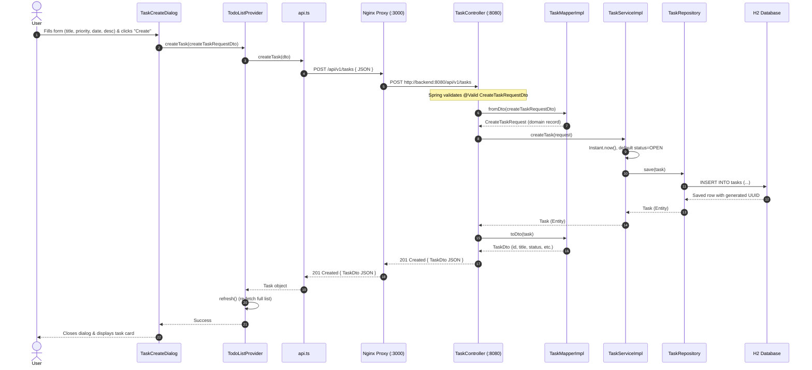
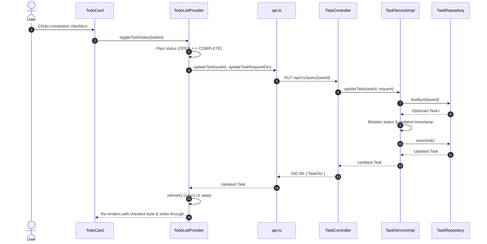
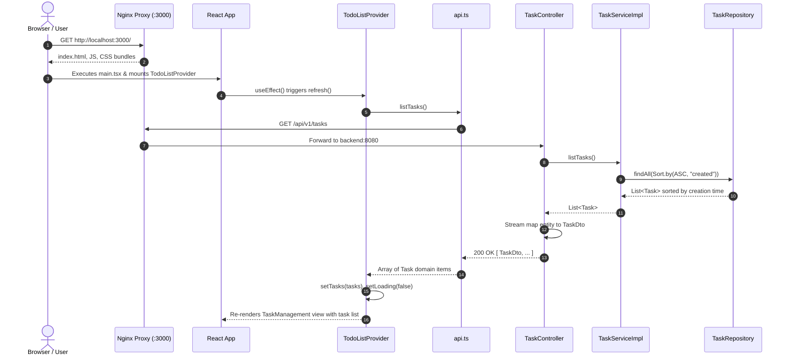
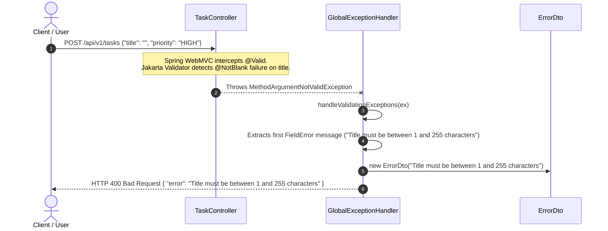

# 6. Runtime View

The Runtime View describes the dynamic behavior, interactions, and call sequences for key architectural scenarios.

---

## 6.1 Scenario 1: Task Creation Workflow

This scenario illustrates the complete end-to-end flow when a user creates a new task.

---

## 6.2 Scenario 2: Task Status Toggle (Quick Action)

When the user clicks the checkbox on a `TodoCard` to toggle a task from `OPEN` to `COMPLETE` or vice versa:

---

## 6.3 Scenario 3: Task Retrieval on Application Startup

When the user opens the application in a browser:

---

## 6.4 Scenario 4: Validation Failure and Exception Handling

When a client submits invalid data (e.g., an empty title or a due date in the past):

