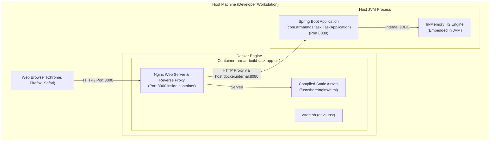

# 7. Deployment View

The Deployment View describes the physical and containerized infrastructure, network channels, and deployment topology.

---

## 7.1 Infrastructure & Environment Topology

The project utilizes a hybrid container-and-host deployment strategy for development and local testing. The frontend application is packaged and executed inside an isolated Docker container, while the backend runs as a native JVM process on the host machine.



---

## 7.2 Docker & Containerization Details

### Multi-Stage Dockerfile (`frontend/Dockerfile`)

The frontend container is built using a two-stage Dockerfile to minimize final image footprint and security attack surface:

1. **Build Stage (`node:22-alpine`)**:
   - Copies `package.json` and `package-lock.json`.
   - Runs `npm ci` for deterministic, clean dependency installation.
   - Executes `npm run build` (`tsc -b && vite build`) to produce optimized static assets in `/app/dist`.
2. **Production Stage (`nginx:alpine`)**:
   - Installs `gettext` (`envsubst`).
   - Copies `/app/dist` to `/usr/share/nginx/html`.
   - Copies `nginx.conf.template` to `/etc/nginx/nginx.conf.template`.
   - Executes `start.sh` to inject runtime environment variables into the Nginx configuration.

### Dynamic Nginx Reverse Proxy Templating

At container startup, `start.sh` replaces placeholders `${BACKEND_HOST}` and `${BACKEND_PORT}` in `nginx.conf.template` using `envsubst`:

```bash
#!/bin/sh
envsubst '${BACKEND_HOST} ${BACKEND_PORT}' < /etc/nginx/nginx.conf.template > /etc/nginx/nginx.conf
exec nginx -g 'daemon off;'
```

#### Core Nginx Configuration Behavior:
- **Static Assets**:
  ```nginx
  location / {
      root /usr/share/nginx/html;
      try_files $uri $uri/ /index.html;
  }
  ```
  Ensures client-side SPA routing functions correctly by serving `index.html` for non-file routes.
- **API Pass-Through**:
  ```nginx
  location /api/ {
      proxy_pass http://${BACKEND_HOST}:${BACKEND_PORT}/api/;
      proxy_set_header Host $host;
      proxy_set_header X-Real-IP $remote_addr;
      proxy_set_header X-Forwarded-For $proxy_add_x_forwarded_for;
      proxy_set_header X-Forwarded-Proto $scheme;
  }
  ```
  Proxies all `/api/*` traffic transparently to the backend host.

---

## 7.3 Docker Compose Configuration (`docker-compose.yml`)

```yaml
name: arman-build-task-app
services:
  ui:
    build: ./frontend
    ports:
      - "3000:3000"
    environment:
      - BACKEND_HOST=host.docker.internal
      - BACKEND_PORT=8080
    extra_hosts:
      - "host.docker.internal:host-gateway"
```

### Key Network Configuration Elements
- **`extra_hosts: ["host.docker.internal:host-gateway"]`**: Enables the Linux/macOS Docker container to communicate back to the host machine's `localhost` network namespace where Spring Boot runs on port `8080`.
- **`ports: ["3000:3000"]`**: Maps the host port 3000 to Nginx port 3000.
