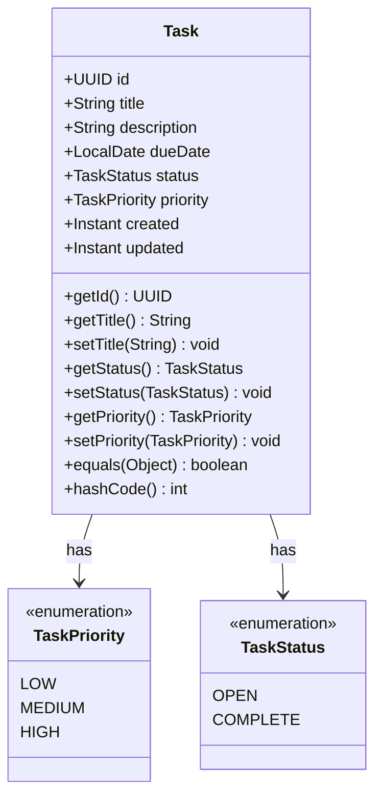
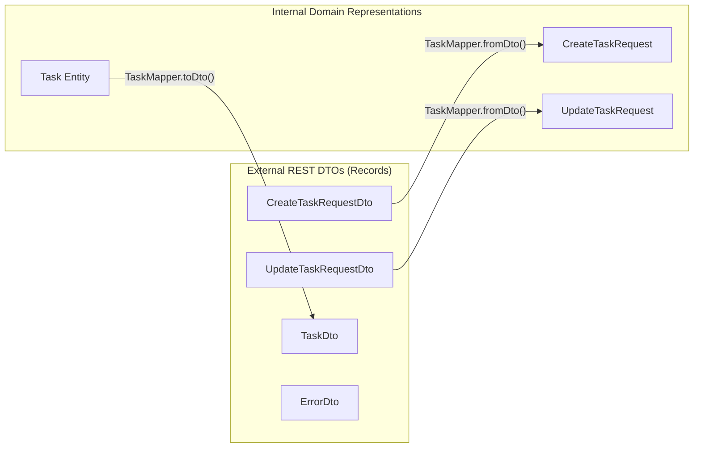
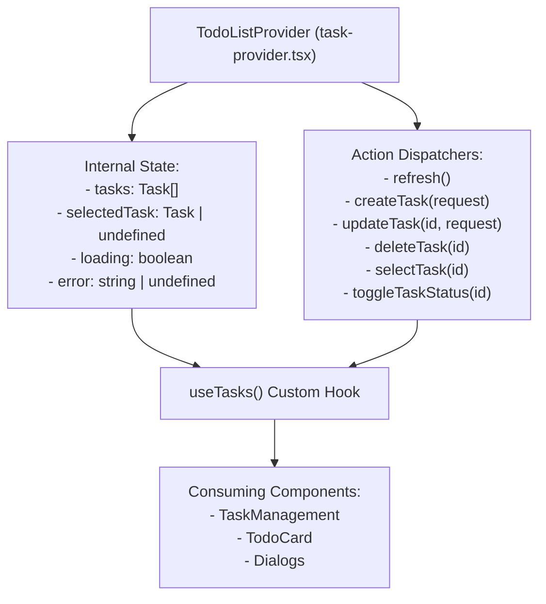

# 8. Cross-Cutting Concepts

Cross-cutting concepts describe architectural patterns, standards, and rules applied consistently across multiple layers and components.

---

## 8.1 Domain Model & Entity Design

The core domain model centers around the `Task` aggregate entity:



### Entity Persistence Constraints
- **Identity (`id`)**: Primary key of type `UUID`, automatically generated via JPA `@GeneratedValue(strategy = GenerationType.UUID)`. Entity equality (`equals` and `hashCode`) is strictly bound to the `id` property, ensuring consistent behavior across JPA persistence states.
- **Title (`title`)**: `nullable = false`, constrained to 255 characters.
- **Description (`description`)**: `length = 1000`, allows null values.
- **Timestamps (`created`, `updated`)**: `created` is marked `updatable = false, nullable = false`. Both utilize `java.time.Instant` representing UTC points in time.
- **Due Date (`dueDate`)**: `java.time.LocalDate` representing date-only values (without time zone bias).

---

## 8.2 Data Transfer Objects (DTO) vs Domain Requests

The system enforces a strict boundary between HTTP serialization contracts and internal domain representations:



- **DTOs (`CreateTaskRequestDto`, `UpdateTaskRequestDto`)**: Contain Jakarta validation annotations (`@NotBlank`, `@Length`, `@FutureOrPresent`, `@NotNull`) and validation error message constants.
- **Domain Requests (`CreateTaskRequest`, `UpdateTaskRequest`)**: Clean Java records containing sanitized data passed to `TaskService`. Free from validation annotation dependencies.

---

## 8.3 Centralized Validation Strategy

Data validation occurs at the system ingress boundary before executing business logic:

1. **Controller Binding**: Endpoints decorate input DTOs with `@Valid` (`@Valid @RequestBody CreateTaskRequestDto`).
2. **Constraint Enforcement**:
   - `title`: `@NotBlank` and `@Length(max = 255)` &rarr; *"Title must be between 1 and 255 characters"*
   - `description`: `@Length(max = 1000)` &rarr; *"Description must be less than 1000 characters"*
   - `dueDate`: `@FutureOrPresent` &rarr; *"Due date must be in the future"*
   - `priority`: `@NotNull` &rarr; *"task priority must be provided"*
   - `status`: `@NotNull` &rarr; *"Task status must be provided"* (update endpoint only)
3. **Short-Circuit Error Reporting**: If validation fails, Spring throws `MethodArgumentNotValidException`, bypassing controller method execution entirely.

---

## 8.4 Global Exception Handling & Error Response Contract

The `GlobalExceptionHandler` (`@ControllerAdvice`) provides deterministic error responses:

```json
{
  "error": "Title must be between 1 and 255 characters"
}
```

### Exception Mappings:

| Exception | HTTP Status Code | Response Body | Description |
| :--- | :--- | :--- | :--- |
| `MethodArgumentNotValidException` | `400 Bad Request` | `{"error": "<first validation failure message>"}` | Triggered on Jakarta validation failures. Extracts the first field error to provide actionable feedback. |
| `TaskNotFoundException` | `400 Bad Request` | `{"error": "Task with ID '<UUID>' not found"}` | Triggered when updating a non-existent task. Extracts the missing ID. |

---

## 8.5 Client-Side State Management

State management in the React frontend uses the React Context API with custom hooks:



### Design Principles:
- **Single Source of Truth**: All tasks are stored in a centralized array inside `TodoListProvider`.
- **Automatic Synchronization**: After mutating operations (`createTask`, `updateTask`, `deleteTask`), the provider executes `refresh()` to synchronize the UI with server state.
- **Fail-Safe Error State**: Any caught network or HTTP error sets the `error` state in context and bubbles to UI alerts or toast notifications via Sonner.
