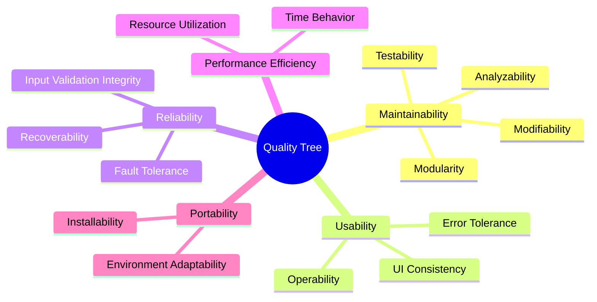

# 10. Quality Requirements

This section details the software quality tree and concrete quality scenarios evaluated against the system architecture, structured in accordance with ISO/IEC 25010 and the Architecture Tradeoff Analysis Method (ATAM).

---

## 10.1 Quality Tree (ISO/IEC 25010)

---

## 10.2 ATAM Quality Scenarios

### Scenario 1: Maintainability & Testability (High Priority)
- **Source**: Development Team
- **Stimulus**: A developer introduces a new attribute on tasks (e.g., `category` or `tags`).
- **Artifact**: DTO records, `TaskMapperImpl`, `Task` entity, and React form dialogs.
- **Environment**: Routine feature development in IDE.
- **Response**: The developer adds the field to `TaskDto`, `CreateTaskRequestDto`, updates `TaskMapperImpl`, and adds the column to `Task` entity without modifying controller HTTP mechanics or repository logic.
- **Response Measure**: Change implemented, compiled, and verified via unit tests within < 30 minutes without regression in existing endpoints.

### Scenario 2: Reliability & Validation Integrity (High Priority)
- **Source**: Malformed client request (external user or automated script).
- **Stimulus**: HTTP `POST /api/v1/tasks` is sent with an empty title and a past due date.
- **Artifact**: `TaskController` & `GlobalExceptionHandler`.
- **Environment**: Normal operation under production or staging load.
- **Response**: Jakarta Validation detects the constraint breach before controller method invocation; `GlobalExceptionHandler` intercepts `MethodArgumentNotValidException` and returns HTTP `400 Bad Request` with `{ "error": "Title must be between 1 and 255 characters" }`.
- **Response Measure**: 100% of invalid payloads are rejected with HTTP 400; zero malformed records are inserted into the database.

### Scenario 3: Usability & Error Feedback (Medium Priority)
- **Source**: End user interacting with UI.
- **Stimulus**: Backend service is temporarily offline or unreachable while user submits a task.
- **Artifact**: Frontend `api.ts`, `TodoListProvider`, Sonner toast notification.
- **Environment**: Network outage or stopped backend container.
- **Response**: `api.ts` catches network failure and produces a friendly error message (*"Request failed, is the backend running?"*); the provider populates error state and displays a visible UI alert.
- **Response Measure**: User is alerted immediately (< 200 ms) with actionable guidance; UI remains interactive and does not crash.

### Scenario 4: Portability & Developer Onboarding (Medium Priority)
- **Source**: New developer joining the project.
- **Stimulus**: Developer clones git repository on a clean workstation with only JDK 25 and Docker installed.
- **Artifact**: Build scripts (`./mvnw`), `docker-compose.yml`, multi-stage Dockerfile.
- **Environment**: Clean macOS, Linux, or Windows (WSL2) machine.
- **Response**: Developer executes `./mvnw spring-boot:run` and `docker compose up`; full application stack starts successfully.
- **Response Measure**: System is fully running and accessible at `http://localhost:3000` within 5 minutes of cloning.
