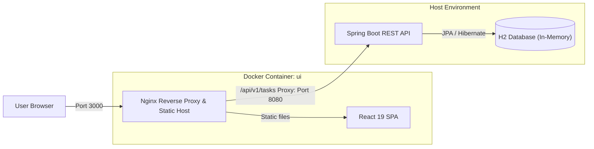

# arc42 Software Architecture Document

**System Name**: Task Management Application  
**Version**: 0.0.1-SNAPSHOT  
**Authors**: Engineering Team  
**Standard**: arc42 Template Version 8.2 (ISO/IEC/IEEE 42010 compliant)  

---

## Table of Contents

1. [Introduction and Goals](./01_introduction_and_goals.md)
   - 1.1 Requirements Overview
   - 1.2 Quality Goals
   - 1.3 Stakeholders
2. [Architecture Constraints](./02_architecture_constraints.md)
   - 2.1 Technical Constraints
   - 2.2 Organizational Constraints
   - 2.3 Conventions & Standards
3. [Context and Scope](./03_context_and_scope.md)
   - 3.1 Business Context
   - 3.2 Technical Context & Interfaces
4. [Solution Strategy](./04_solution_strategy.md)
   - 4.1 Key Architecture Decisions
   - 4.2 Technology Selection & Rationale
5. [Building Block View](./05_building_block_view.md)
   - 5.1 Whitebox Overall System (Level 1)
   - 5.2 Whitebox Backend Subsystem (Level 2)
   - 5.3 Whitebox Frontend Subsystem (Level 2)
   - 5.4 Internal Component Details (Level 3)
6. [Runtime View](./06_runtime_view.md)
   - 6.1 Task Creation Flow
   - 6.2 Task Status Toggle & Update Flow
   - 6.3 Task Retrieval & Initial State Hydration
   - 6.4 Task Deletion Flow
   - 6.5 Validation & Exception Handling Flow
7. [Deployment View](./07_deployment_view.md)
   - 7.1 Infrastructure & Environment Topology
   - 7.2 Docker & Reverse Proxy Configuration
   - 7.3 Development vs Production Topologies
8. [Cross-cutting Concepts](./08_crosscutting_concepts.md)
   - 8.1 Domain & Entity Model
   - 8.2 API & REST Conventions
   - 8.3 Validation Strategy
   - 8.4 Exception & Error Handling Strategy
   - 8.5 Client-Side State Management
9. [Architectural Decisions](./09_architectural_decisions.md)
   - 9.1 Summary of Architecture Decision Records (ADRs)
10. [Quality Requirements](./10_quality_requirements.md)
    - 10.1 Quality Tree (ISO/IEC 25010)
    - 10.2 ATAM Quality Scenarios
11. [Risks and Technical Debt](./11_risks_and_technical_debt.md)
    - 11.1 Identified Technical Risks
    - 11.2 Known Technical Debt & Remediation
12. [Glossary](./12_glossary.md)
    - 12.1 Domain Terminology
    - 12.2 Technical Terminology

---

## Executive Summary

The **Task Management Application** is designed to provide users with an intuitive, responsive, and robust interface for tracking tasks, deadlines, priorities, and completion states. 

The system employs an industry-standard decoupled architecture separating the **Single Page Application (SPA)** frontend built with **React 19, TypeScript, and Tailwind CSS** from the **RESTful Web API** backend powered by **Java 25 and Spring Boot 4**. Data is managed through **Spring Data JPA** and an embedded **H2** relational database. Frontend assets and API proxying are encapsulated within an **Nginx-driven Docker container**, isolating environment differences and eliminating CORS complexities during local development.

