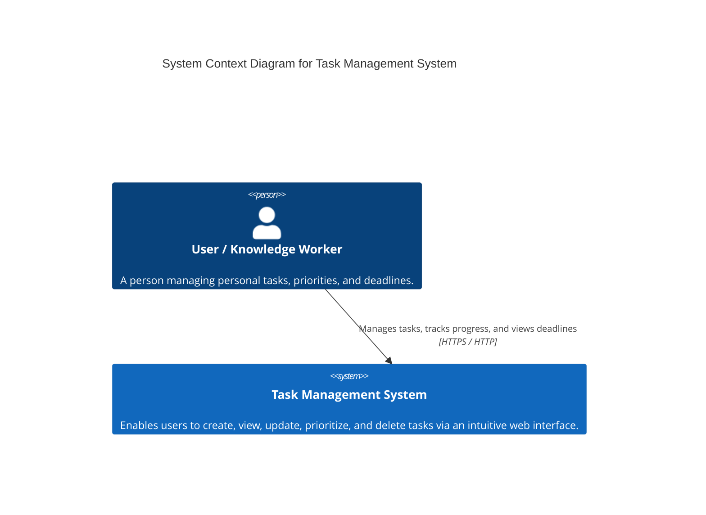

# C4 Model - Level 1: System Context Diagram

The System Context diagram provides the highest-level view of the software system, showing the boundary of the **Task Management System** and how human actors interact with it.

---

## 🖼️ System Context Diagram

---

## 🔍 Context Elements

### People / Actors

| Element | Role | Description |
| :--- | :--- | :--- |
| **User** | Knowledge Worker | Interacts with the Task Management System through modern web browsers (desktop and mobile) to organize daily activities. |

### Systems

| Element | Classification | Description |
| :--- | :--- | :--- |
| **Task Management System** | Software System | The system under design. Provides complete task lifecycle management (CRUD), due date validation, priority classification, and real-time client feedback. |

### External Dependencies
Currently, the Task Management System is intentionally self-contained:
- It does not depend on third-party SaaS APIs (such as external auth providers or notification services).
- All authentication, notifications, and persistence are self-hosted or embedded in the local environment.
