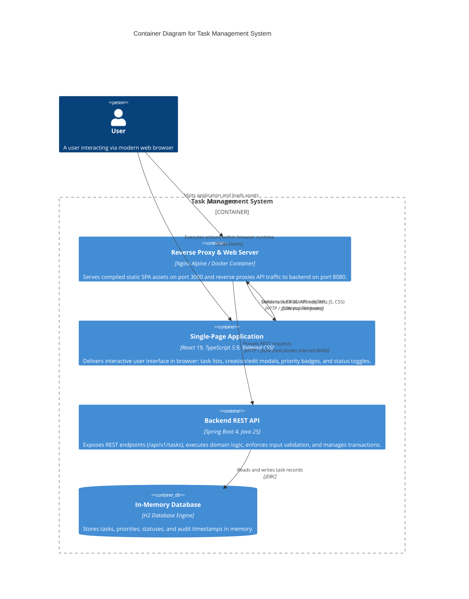

# C4 Model - Level 2: Container Diagram

The Container diagram decomposes the Task Management System into its constituent deployable and runnable units (applications, data stores, and containers).

---

## 🖼️ Container Diagram

---

## 🔍 Container Specifications

| Container | Technology | Responsibilities | Networking / Ports |
| :--- | :--- | :--- | :--- |
| **Nginx Reverse Proxy** | Nginx Alpine, Docker | - Serves pre-compiled static assets. - Provides SPA routing fallback (`try_files $uri /index.html`). - Proxies `/api/*` to the Spring Boot backend. | Listens on port `3000` (Docker host port mapped `3000:3000`). |
| **Single-Page Application (SPA)** | React 19, TypeScript, Tailwind CSS, Radix UI | - Executes within the user's browser runtime. - Renders responsive UI components. - Dispatches asynchronous API calls via `fetch`. - Manages local state via React Context. | Browser memory / client execution. |
| **Backend REST API** | Java 25, Spring Boot 4.0.9, Spring MVC, Spring Data JPA | - Validates incoming request payloads (`@Valid`). - Translates DTOs to domain models. - Coordinates business logic and timestamp generation. - Intercepts and formats errors via `@ControllerAdvice`. | Listens on host port `8080`. |
| **In-Memory Database** | H2 Database Engine | - Persists table `tasks` with UUID keys. - Automatically created on startup via Hibernate DDL. | Embedded in-process inside Spring Boot JVM (`jdbc:h2:mem:taskdb`). |
