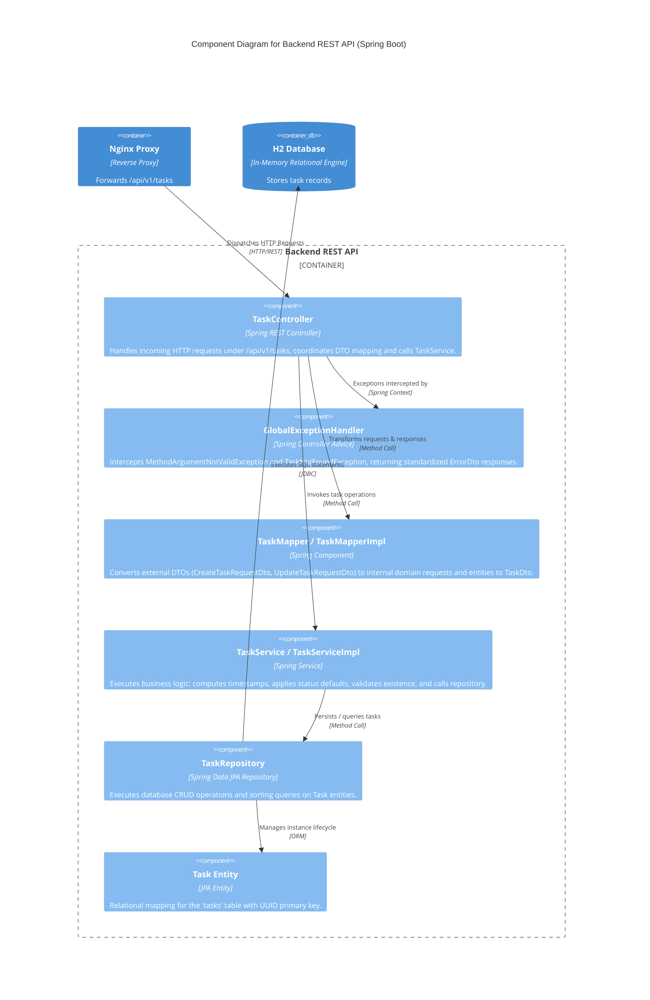
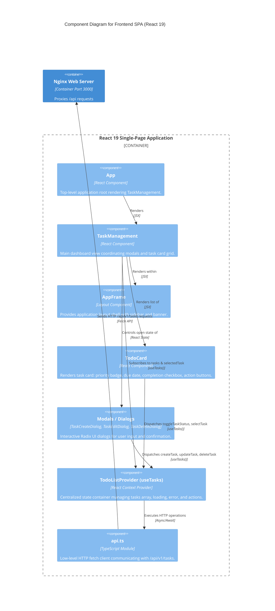

# C4 Model - Level 3: Component Diagrams

The Component diagrams zoom inside individual containers to reveal their internal structural blocks, components, interfaces, and dependencies.

---

## 🖼️ 1. Backend API Components (`task`)

### Backend Component Catalog

| Component | Type | Responsibility | Interface / Contract |
| :--- | :--- | :--- | :--- |
| **`TaskController`** | `@RestController` | Entry point for `/api/v1/tasks`. Enforces validation on input DTOs, returns `ResponseEntity<TaskDto>` or `ResponseEntity<List<TaskDto>>`. | `POST /`, `GET /`, `PUT /{taskId}`, `DELETE /{taskId}` |
| **`GlobalExceptionHandler`** | `@ControllerAdvice` | Intercepts bean validation failures and entity missing exceptions. Formats consistent error payloads. | `@ExceptionHandler(MethodArgumentNotValidException.class)`, `@ExceptionHandler(TaskNotFoundException.class)` |
| **`TaskMapper`** | `@Component` | Bidirectional conversion between API DTOs and internal domain representations. | `fromDto(CreateTaskRequestDto)`, `fromDto(UpdateTaskRequestDto)`, `toDto(Task)` |
| **`TaskService`** | `@Service` | Pure business logic: enforces chronological sort (`created ASC`), initializes `Instant.now()` timestamps, updates status. | `createTask()`, `listTasks()`, `updateTask()`, `deleteTask()` |
| **`TaskRepository`** | `@Repository` | JPA repository abstraction over `Task` entity. | Extends `JpaRepository<Task, UUID>` |

---

## 🖼️ 2. Frontend SPA Components (`frontend`)

### Frontend Component Catalog

| Component | Responsibility |
| :--- | :--- |
| **`TodoListProvider`** | Implements React Context (`TaskContext`), holding `tasks`, `selectedTask`, `loading`, `error`, and exposing mutation functions. Automatically re-synchronizes via `refresh()`. |
| **`TaskManagement`** | Renders header counters (`data-testid="task-count-total"`), orchestrates visibility state for creation, editing, and deletion dialogs. |
| **`TodoCard`** | Renders an individual task with styling according to `TaskPriority` and `TaskStatus`. Fires `toggleTaskStatus(taskId)`. |
| **`TaskCreateDialog` / `TaskEditDialog` / `TaskDeleteDialog`** | Controlled dialog forms capturing title, description, priority, and date inputs, with client-side validation before dispatching to the provider. |
| **`api.ts`** | Encapsulates Fetch API requests, stringifies request bodies, parses JSON responses, and translates HTTP error statuses into thrown errors. |
