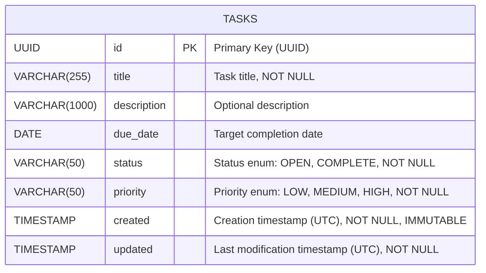
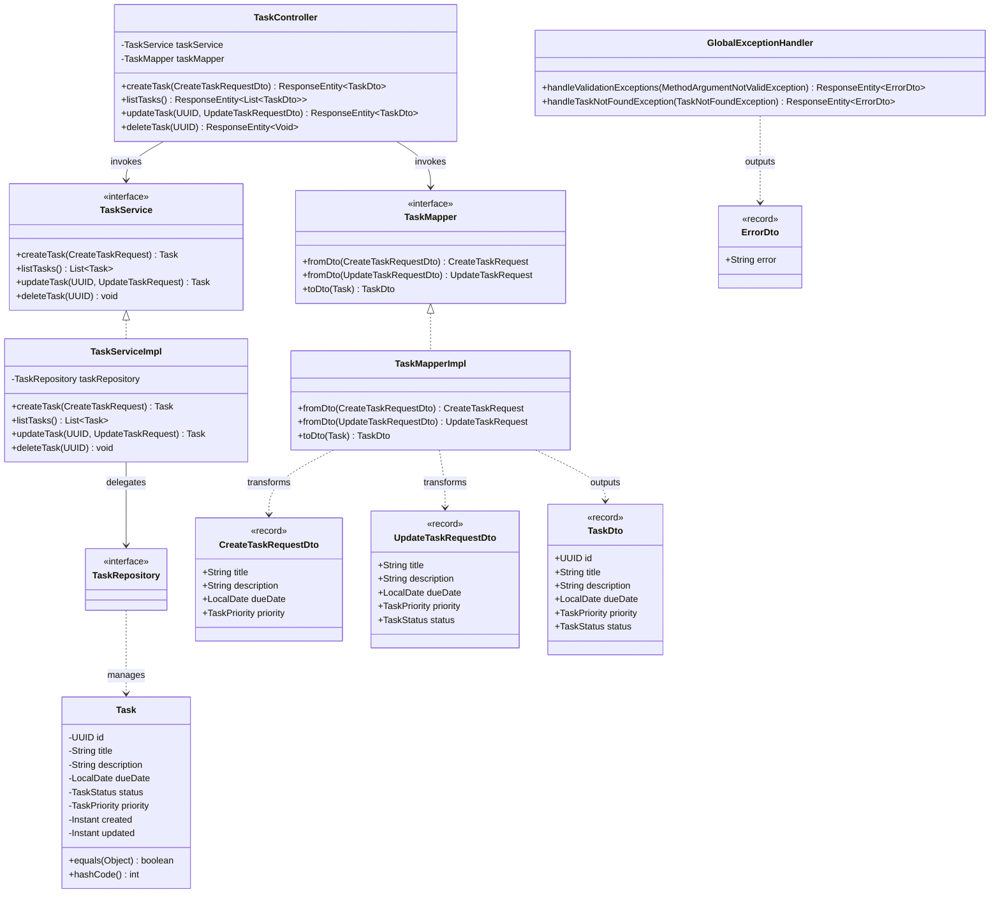

# C4 Model - Level 4: Code & Data Model

The Code and Data Model level zooms into the structural mechanics: object-oriented class hierarchies, immutable records, data contracts, and relational database schema definitions.

---

## 🗄️ 1. Relational Database Schema (Entity-Relationship)



### Table Properties & Indexing:
- **Table Name**: `tasks`
- **Primary Key**: `id` (`UUID`)
- **Nullability Rules**:
  - `title`, `status`, `priority`, `created`, `updated` are `NOT NULL`.
  - `description` and `due_date` are nullable.
- **Sorting Default**: Indexed and ordered by `created ASC` during `TaskServiceImpl.listTasks()`.

---

## ☕ 2. Backend Class & Record Hierarchy



---

## ⚛️ 3. Frontend TypeScript Domain Contracts

```typescript
// frontend/src/types/task.ts

export enum TaskPriority {
  LOW = "LOW",
  MEDIUM = "MEDIUM",
  HIGH = "HIGH",
}

export enum TaskStatus {
  OPEN = "OPEN",
  COMPLETE = "COMPLETE",
}

export interface Task {
  id: string;
  title: string;
  description?: string;
  dueDate?: string;
  priority: TaskPriority;
  status: TaskStatus;
}
```

```typescript
// frontend/src/lib/api.types.ts

export interface CreateTaskRequestDto {
  title: string;
  description?: string;
  dueDate?: string;
  priority: TaskPriority;
}

export interface UpdateTaskRequestDto {
  title: string;
  description?: string;
  dueDate?: string;
  priority: TaskPriority;
  status: TaskStatus;
}

export interface ApiErrorResponseDto {
  error: string;
}
```
