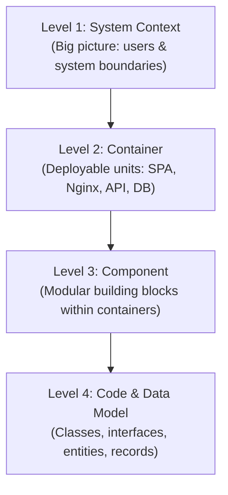

# C4 Architectural Model

The **C4 Model** (created by Simon Brown) is a standard architectural visualization framework that provides a hierarchical set of software architecture diagrams. It decomposes systems into four intuitive levels of abstraction:

---

## 📑 C4 Model Diagram Catalogue

| Level | Document | Scope & Focus | Target Audience |
| :---: | :--- | :--- | :--- |
| **Level 1** | **[01. System Context Diagram](./01-system-context.md)** | Shows the Task Management System in the context of its human users and external world boundaries. | All stakeholders, product managers, developers |
| **Level 2** | **[02. Container Diagram](./02-container-view.md)** | Decomposes the system into high-level deployable units (Single Page App, Reverse Proxy, REST API, Database) and network protocols. | Software architects, DevOps, developers |
| **Level 3** | **[03. Component Diagrams](./03-component-view.md)** | Zooms into individual containers to illustrate internal components (Controllers, Services, Mappers, Repositories, Providers, Dialogs). | Software engineers, code reviewers |
| **Level 4** | **[04. Code & Data Model](./04-code-and-data-model.md)** | Details class structures, DTO contracts, entity relationships, and database schema mappings. | Developers implementing or refactoring code |
